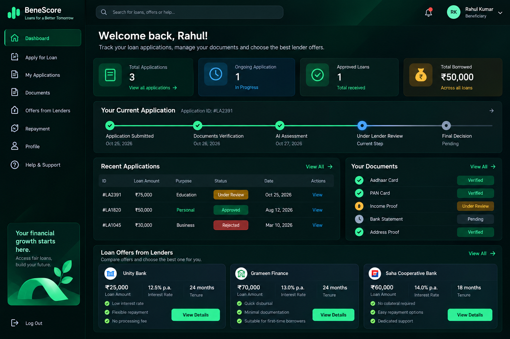

# AI-Powered Digital Lending & Alternative Credit Scoring Platform

A decision-support prototype connecting beneficiaries with lenders through credit risk assessment, income classification, and document-status tracking.

> **Academic prototype.** Uses synthetic data and demo-only verification. Scores are illustrative and are NOT lending decisions. OCR/checksum checks do not prove document authenticity, and no government API is integrated.

## Overview
Traditional lending relies heavily on credit history, which excludes first-time borrowers. This platform evaluates financial inputs and alternative indicators (income, expenses, EMI, repayment behaviour, electricity usage) to support lender decisions.

## Project Status
| Layer | Status |
|---|---|
| Frontend (React + TS + Tailwind) | Built, runs on demo data or the backend |
| Backend (Spring Boot + MySQL) | Built, rule-based scoring until the ML service exists |
| ML service (FastAPI) | Planned |
| Integration | Frontend and backend connected; ML service still planned |

Development order: Frontend (mock) -> Backend -> ML -> Integration.

## Key Features
**Beneficiary Portal:** apply for loans, upload documents, track application and document status, compare lender offers.
**Lender Portal:** review applications and beneficiary profiles, view risk insights, approve / reject / request info (demo actions), create offers, track disbursements (mock).
**Credit Assessment:** risk score and category (LOW / MEDIUM / HIGH), income bracket, composite score and segment, SHAP-style explanations.
**Document Status Tracking:** upload, basic checks, and a clearly labelled status showing what has and has not been verified.

## Score Conventions
- `risk_score` 0-100: higher = greater risk
- `composite_score` 0-100: higher = more favourable
- `verification_status`: DEMO_UNVERIFIED | DOCUMENT_UPLOADED | CHECKS_PASSED | CHECKS_FAILED | NOT_PROVIDED

## Tech Stack
React, TypeScript, Tailwind CSS, Recharts | Java 21, Spring Boot | Python, FastAPI, scikit-learn | MySQL | Git, GitHub

## Workflow
1. Beneficiary submits a loan request and optional documents.
2. System runs document checks and the credit assessment.
3. Lender reviews the application and risk insights.
4. Lender makes an offer or rejects.
5. Beneficiary compares and accepts an offer.

## Repository Structure
beneficiary-credit-scoring/
  frontend/  backend/  ml-service/  verification/  sample-data/


## Architecture

```text
Beneficiary / Lender
        |
   React Frontend
        |
  Spring Boot Backend
        |
   +----+------+
   |           |
 MySQL      FastAPI
 Database   ML Service
               |
        Credit Risk Assessment
```



